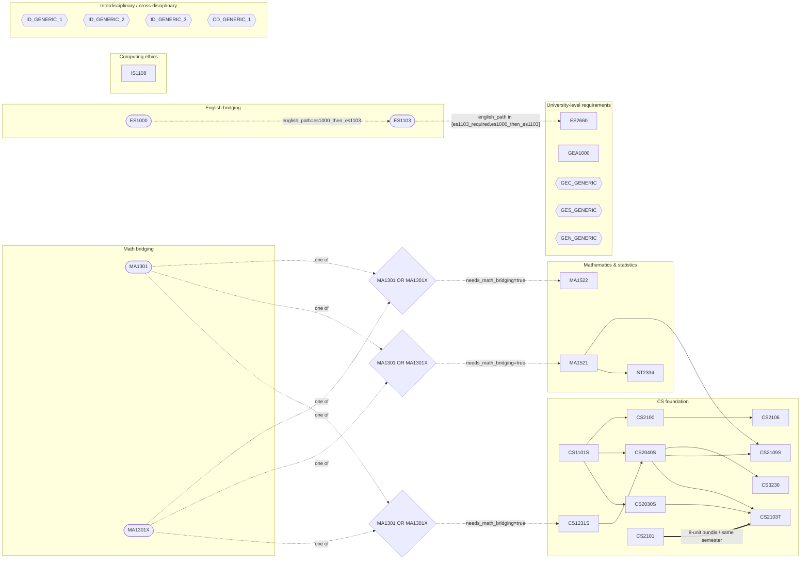

# Iteration 1 prerequisite graph

Generated from `data/modules.yaml`.

- Solid arrow: ordinary prerequisite
- Dashed arrow: conditional / bridging prerequisite
- Dotted bidirectional edge: corequisite
- Generic GE/ID/CD nodes are placeholders, not specific real modules

## Current conditional pathways

- Math bridging: if `needs_math_bridging=true`, satisfy MA1301 or MA1301X before MA1521, MA1522, and CS1231S.
- English baseline: `english_path=direct_es2660` adds no English bridge.
- English path `es1103_required`: ES1103 must be satisfied before ES2660.
- English path `es1000_then_es1103`: ES1000 -> ES1103 -> ES2660.
